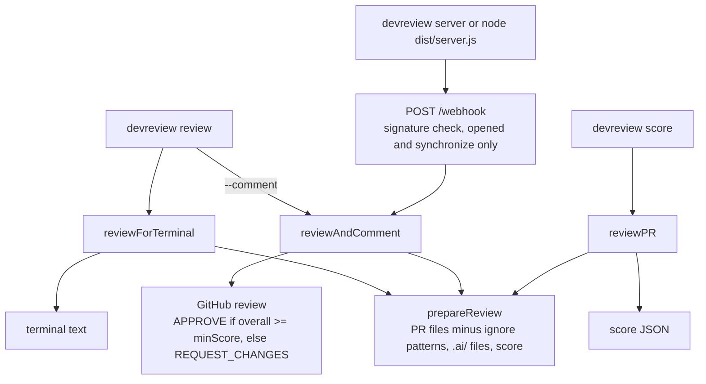

# DevReview configuration, webhook mode, and Docker

Reference material for the [DevReview README](../README.md).

## Environment variables

```bash
GITHUB_TOKEN=your-token
WEBHOOK_SECRET=your-webhook-secret
PORT=3000
DEVREVIEW_CONFIG=.devreview.json
```

- `GITHUB_TOKEN`: required (or pass `--token`).
- `WEBHOOK_SECRET`: required for `devreview server` (or pass `--secret`).
- `PORT`: optional, default 3000 (or pass `--port`).
- `DEVREVIEW_CONFIG`: read only by the container entrypoint `node dist/server.js`; the `devreview` CLI commands use `--config` instead.

The CLI and the server load a `.env` file from the working directory; `.env.example` lists the keys.

DevReview currently uses a GitHub token, not a GitHub App flow.

## `.devreview.json`

Create a `.devreview.json` in the working directory to customize scoring and review rules:

```json
{
  "rules": {
    "requireTests": true,
    "requireDocs": true,
    "minScore": 7
  },
  "ignore": [
    "dist/**",
    "coverage/**",
    "node_modules/**"
  ],
  "scoring": {
    "codeQuality": 30,
    "architecture": 25,
    "testing": 20,
    "documentation": 15,
    "bestPractices": 10
  }
}
```

`rules.minScore` decides between APPROVE and REQUEST_CHANGES when a review is posted, for `devreview review --comment` and for the webhook server. `devreview review --comment --min-score <n>` overrides the file value for that run. Without the flag, `devreview review` uses `rules.minScore` from the file, and the built-in default of 7 when the file or the key is absent. Without `--comment` the value has no effect.

## GitHub token requirements

Submitting a review (`--comment` and the webhook server) needs a token that may write pull requests: the fine-grained permission "Pull requests: write" on the repository (see [permissions required for fine-grained personal access tokens](https://docs.github.com/en/rest/authentication/permissions-required-for-fine-grained-personal-access-tokens), endpoint `POST /repos/{owner}/{repo}/pulls/{pull_number}/reviews`), or `repo` for a classic token (`public_repo` is enough for public repositories; see [scopes for OAuth apps](https://docs.github.com/en/apps/oauth-apps/building-oauth-apps/scopes-for-oauth-apps)). Terminal output and `devreview score` only read the pull request. GitHub does not let authors approve their own pull requests ([reviewing proposed changes](https://docs.github.com/en/pull-requests/collaborating-with-pull-requests/reviewing-changes-in-pull-requests/reviewing-proposed-changes-in-a-pull-request)), so an APPROVE review from the account that opened the pull request is rejected: `devreview review --comment` exits with an error and the webhook server logs it. Use a token of a different account (for example a bot) to review pull requests you open yourself.

`ignore` replaces the built-in list (`dist/**`, `build/**`, `node_modules/**`, `*.lock`, `package-lock.json`, `yarn.lock`), so repeat any of those you still want. Patterns match the whole file path from the repository root: `*` and `?` do not cross `/`, `**` does. `rules` and `scoring` are merged with the defaults, so partial objects are fine.

## How a review runs

All entry points share one pipeline: fetch the pull request and its files, drop files that match `ignore`, fetch the `.ai/` files, and score. They differ in the output. `devreview review` prints terminal text, `devreview score` prints the score as JSON, and `devreview review --comment` and the webhook server post a GitHub review whose event depends on `minScore`. The flowchart shows which entry point posts to GitHub.



## Webhook mode

The server listens on:

- `POST /webhook`
- `GET /health`

It reacts to `pull_request` events with the actions `opened` and `synchronize`. For each of them it submits a review with event `APPROVE` (overall score at or above `rules.minScore`) or `REQUEST_CHANGES` (below it), so each push to a pull request gets a new review. An approval from the token's account can count toward required reviews in branch protection. If reviews should stay advisory, use a token of an account whose approvals do not count.

### GitHub webhook settings

- Payload URL: the server's base URL followed by `/webhook`.
- Content type: `application/json`. Any other content type fails signature verification and is answered with 401.
- Secret: the value of `WEBHOOK_SECRET`.
- Events: Pull requests. Only `opened` and `synchronize` start a review and get 202; other events get 200. A request without the `X-Hub-Signature-256` header gets 400.

## AI context

DevReview fetches these files from the target repository:

```text
.ai/AGENTS.md
.ai/ARCHITECTURE.md
.ai/DECISIONS.md
```

Only the presence of `.ai/ARCHITECTURE.md` changes the review: it adds a note that project context was available, and its absence adds a recommendation to create it. File contents are not used for scoring.

This is lightweight context enrichment, not full LLM-based review generation.

## Docker

There is no Docker Compose setup. Build the image, then run the webhook server container directly:

```bash
# Build the image (devreview:latest)
make docker-build

# Run the webhook server (exposes port 3000, with a /health check)
docker run --rm -p 3000:3000 \
  -e GITHUB_TOKEN=your-token \
  -e WEBHOOK_SECRET=your-webhook-secret \
  devreview
```

The container entrypoint is `node dist/server.js`, so it always starts in webhook-server mode.

The image contains no `.devreview.json`. The container reads `/app/.devreview.json`, or the path in `DEVREVIEW_CONFIG`, so mount your file, for example `-v "$PWD/.devreview.json:/app/.devreview.json:ro"`.

The image health check probes port 3000. Keep `PORT` at its default inside the container and map another host port with `-p` instead.
